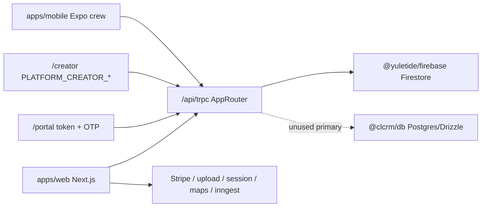

# Yuletide Lighting CRM — Current-State System Inventory

**Product:** Yuletide Lighting CRM (`christmas-light-crm`)  
**Production host:** https://yuletide-lighting.web.app  
**Inventory date:** 2026-07-30  
**Method:** Codebase verification only (no application code changes). Status labels are evidence-based.

### Status legend

| Label | Meaning |
|-------|---------|
| **implemented** | Wired UI + API + data path present and used |
| **partial** | Exists but incomplete, sparsely gated, dual-path, or weakly enforced |
| **mocked** | Deterministic / heuristic stand-in (AI, weather, etc.) |
| **hidden** | Reachable URL or code path not in default primary nav |
| **placeholder** | Stub UI/copy (“coming soon”) or empty shell |
| **not implemented** | Referenced, linked, or planned but missing |

### Architecture snapshot

**Source of truth:** Firestore via `@yuletide/firebase`. Active tRPC app router: `packages/api/src/routers/firestore.ts` (exported from `packages/api/src/index.ts`). Postgres/Drizzle + `packages/api/src/routers/index.ts` are **legacy / unused** as primary store.

---

## 1. Frontend routes

**Verified count:** **202** App Router `page.tsx` files under `apps/web/src/app`.

### Auth gates (middleware + layouts)

| Surface | Gate | Evidence |
|---------|------|----------|
| Public marketing/legal/auth/token/portal prefixes | Middleware skip | `apps/web/src/middleware.ts` |
| `/app/*` | `__session` cookie + `requireAppSession` | middleware + `app/app/layout.tsx` |
| `/creator/*` | session + `isPlatformCreator` | `app/creator/layout.tsx` |
| `/onboarding` | middleware public list, layout still requires session | both |
| `/portal/*`, `/a/`, `/p/`, `/pay/`, `/m/`, `/review/` | Public; token/OTP auth in handlers | portal + public routers |

### 1.1 Marketing / public / auth

| Path | Status | Notes |
|------|--------|-------|
| `/` | implemented | Marketing home (CMS or static) |
| `/pricing` | implemented | |
| `/privacy`, `/terms`, `/subscription-terms`, `/accessibility` | implemented | Legal |
| `/sign-in`, `/sign-in/forgot-password` | implemented | |
| `/sign-up` | implemented | Org signup |
| `/access-denied` | implemented | |
| `/onboarding` | implemented | Post-signup |
| `/[slug]` | implemented | Published CMS pages |

### 1.2 Public token surfaces

| Path | Status | Purpose |
|------|--------|---------|
| `/a/[token]` | implemented | Agreement e-sign |
| `/p/[token]` | implemented | Proposal review/approve |
| `/p/[token]/receipt` | implemented | Signed proposal receipt |
| `/pay/[token]` | implemented | Invoice payment |
| `/m/[token]` | implemented | Mockup approval |
| `/review/[token]` | implemented | Review/feedback |

### 1.3 Customer portal (`/portal/*`) — 24 pages

| Path | Status | Notes |
|------|--------|-------|
| `/portal` | implemented | Redirect → `/portal/login` |
| `/portal/login` | implemented | Enter code/URL |
| `/portal/access/[token]` | implemented | QR landing + OTP |
| `/portal/[token]` | implemented | Home dashboard |
| `/portal/[token]/schedule` | implemented | Feature-gated |
| `/portal/[token]/schedule-request` | **hidden** | Implemented; not in primary portal nav |
| `/portal/[token]/service-request` | implemented | |
| `/portal/[token]/messages` | implemented | |
| `/portal/[token]/notifications` | implemented | |
| `/portal/[token]/contacts` | implemented | |
| `/portal/[token]/sign` | implemented | E-sign hub |
| `/portal/[token]/billing` | implemented | |
| `/portal/[token]/proposals` | implemented | |
| `/portal/[token]/agreements` | implemented | |
| `/portal/[token]/properties` | implemented | |
| `/portal/[token]/mockups` | implemented | |
| `/portal/[token]/documents` | implemented | |
| `/portal/[token]/jobs` | implemented | |
| `/portal/[token]/jobs/[jobId]` | **hidden** | Detail; linked from list |
| `/portal/[token]/takedowns` | implemented | |
| `/portal/[token]/storage` | implemented | |
| `/portal/[token]/consultations` | implemented | |
| `/portal/[token]/reviews` | implemented | Referrals nested here (**partial** dedicated nav) |
| `/portal/[token]/rebook` | implemented | |

### 1.4 Creator console (`/creator/*`)

| Path | Status | Notes |
|------|--------|-------|
| `/creator` | implemented | Overview |
| `/creator/website` | implemented | Website CMS hub |
| `/creator/settings` | implemented | Platform settings |
| `/creator/subscriptions` | implemented | |
| `/creator/modules` | implemented | |
| `/creator/organizations` | implemented | |
| `/creator/organizations/[orgId]` | implemented | |
| `/creator/users` | implemented | |
| `/creator/operations` | implemented | |
| `/creator/ecosystem` | implemented | |
| `/creator/billing` | **hidden** | Alias → operations tab |
| `/creator/audit` | **hidden** | Alias → operations tab |

### 1.5 CRM app (`/app/*`) — summary by area

Redirect-only indexes (**implemented** redirects):

| Path | Target |
|------|--------|
| `/app/inventory/items` | `/app/inventory` |
| `/app/messages` | `/app/messages/dashboard` |
| `/app/mockups` | `/app/mockups/dashboard` |
| `/app/reports` | `/app/reports/dashboard` |
| `/app/schedule` | `/app/schedule/dashboard` |
| `/app/routes` | `/app/schedule/routes` (**hidden** legacy stub) |

**Core CRM pages (implemented unless noted):**  
`/app` (command center), `/app/pipeline`, `/app/customers` (+ `new`, `portal-qr` **hidden**, `[customerId]` + tabs: edit, contacts, properties, property/[propertyId], consultations, sales, designs, jobs, billing, documents, communications, storage, timeline), `/app/contacts`, `/app/properties`, `/app/agreements`, `/app/proposals` (+ new, packages, templates, analytics, `[id]`, edit, present), `/app/commercial` (+ `[accountId]`), `/app/rebooking` (+ campaigns/[id]), `/app/jobs` (+ `[jobId]`), `/app/project-prep`, `/app/crew` (+ jobs/[jobId]), `/app/service-issues`, `/app/time-clock`, `/app/storage` (+ `[storageId]`), `/app/reviews`, `/app/automation`, `/app/website` (**hidden**, creator-gated CMS duplicate).

**Mockups:** `/app/mockups/dashboard|new|[id]|ai|library|templates|measurements|export` — **implemented**; AI studio **mocked**.

**Schedule:** `/app/schedule/dashboard|calendar|dispatch|crews|routes|resources|availability|season-planning|notifications` — **implemented**.

**Inventory:** `/app/inventory` (+ dashboard, items/[id], categories, locations, warehouse, trucks, customers, purchase-orders, transfers, audits, scan, reports) — **implemented**.

**Invoices:** `/app/invoices` (+ dashboard, `[id]`, payments, aging, collections, disputes, reports, settings) — **implemented**.

**Messages:** `/app/messages/dashboard|inbox|conversations|sms|templates|campaigns|automations|internal|reviews|settings` — **implemented**.

**Reports:** `/app/reports/dashboard|sales|financial|operations|customers|inventory|crews|seasonal|forecasting|custom` — **implemented** (forecast/AI often heuristic → **partial**/**mocked** analytics quality).

**Sign tracker / field:**

| Path | Status |
|------|--------|
| `/app/marketing/sign-tracker` (+ add, pickup, report) | implemented |
| `/app/field/signs` (+ add, pickup) | **hidden** |
| `/app/field/signs/report` | **placeholder** (instructs report from job; links to missing `/app/field`) |
| `/app/field` | **not implemented** (linked, no `page.tsx`) |

**Settings (all implemented thin wrappers):**  
`/app/settings` + company, locations, warehouses, vendors, numbering, audit, users, roles, branding, ui, templates, agreements, season, notifications, automation, proposals, invoices, jobs, inventory, customer-portal, portal-qr, integrations (**partial** connectors), import, subscription, ai, security, reports, system.

### 1.6 Mobile app routes (`apps/mobile`)

| Route | Status | Notes |
|-------|--------|-------|
| `index` | implemented | Crew home / schedule |
| `job/[id]` | implemented | Job details |
| `(tabs)/signs` | implemented | Sign pickup |

**partial** vs full CRM field surface (crew + signs only).

---

## 2. Navigation items and submenus

Canonical defaults: `packages/types/src/crm-ui-config.ts` → `DEFAULT_CRM_NAV_ITEMS`.  
Shell: `apps/web/src/components/app-shell.tsx`.  
Resolver: `packages/firebase/src/crm-ui-config.ts` / `trpc.crmUiConfig.resolvedNav`.

### 2.1 CRM sidebar (primary)

| Section | Label | Href | Gates | Status |
|---------|-------|------|-------|--------|
| Home | Dashboard | `/app` | — | implemented |
| Sales | Leads & Pipeline | `/app/pipeline` | module `pipeline`, perm `customers` | implemented |
| Sales | Customers | `/app/customers` | module `customers`, perm `customers` | implemented |
| Sales | Contacts | `/app/contacts` | module `customers`, perm `customers` | implemented |
| Sales | Properties | `/app/properties` | module `customers`, perm `customers` | implemented |
| Sales | Mockups | `/app/mockups` | module `mockups`, perm `mockups` | implemented |
| Sales | Proposals | `/app/proposals` | module `proposals`, perm `proposals` | implemented |
| Sales | Agreements | `/app/agreements` | perm `proposals` (no moduleKey) | implemented |
| Sales | Commercial Accounts | `/app/commercial` | module `commercial`, perm `customers` | implemented |
| Sales | Rebooking | `/app/rebooking` | module `rebooking`, perm `customers` | implemented |
| Operations | Jobs | `/app/jobs` | module `jobs`, perm `jobs` | implemented |
| Operations | Project Prep | `/app/project-prep` | module `jobs`, perm `jobs` | implemented |
| Operations | Schedule | `/app/schedule` | module `schedule`, perm `jobs` | implemented |
| Operations | Routes | `/app/routes` | module `routes`, perm `jobs` | **partial** (redirect) |
| Operations | Crew | `/app/crew` | module `crew`, perm `jobs` | implemented |
| Operations | Service Issues | `/app/service-issues` | module `jobs`, perm `jobs` | implemented |
| Operations | Time Clock | `/app/time-clock` | module `time_clock`, perm `jobs` | implemented |
| Inventory | Customer Storage | `/app/storage` | module `storage`, perm `inventory` | implemented |
| Inventory | Inventory | `/app/inventory` | module `inventory`, perm `inventory` | implemented |
| Finance | Invoices | `/app/invoices` | module `invoices`, perm `invoices` | implemented |
| Marketing | Messages | `/app/messages` | module `messages` | implemented |
| Marketing | Reviews & Referrals | `/app/reviews` | module `reviews` | implemented |
| Marketing | Sign Tracker | `/app/marketing/sign-tracker` | *(no `moduleKey` despite `sign_tracker` module)* | **partial** gating |
| Admin | Automation | `/app/automation` | module `automation` | implemented |
| Admin | Reports | `/app/reports` | module `reports`, perm `reports` | implemented |
| Admin | Settings | `/app/settings` | — | implemented |

**Creator footer links:** Website CMS → `/creator/website`; Creator Console → `/creator` (**implemented**, creator-gated).  
**Billing lock:** sidebar collapses to Subscription only (**implemented**).

### 2.2 Submenus (module section navs)

| Module | Items (hrefs) | Source |
|--------|---------------|--------|
| Schedule | dashboard, calendar, dispatch, crews, routes, resources, availability, season-planning, notifications | `schedule-utils` / `schedule-nav` |
| Invoices | dashboard, invoices, payments, collections, aging, disputes, reports, settings | `invoice-utils` / `invoice-nav` |
| Messages | dashboard, sms, inbox, conversations, campaigns, templates, automations, internal, reviews, settings | `message-utils` / `message-nav` |
| Inventory | items, locations, scan, analytics, categories, warehouse, trucks, customer-owned, POs, transfers, audits, reports | `inventory-utils` / `inventory-nav` |
| Mockups | dashboard, new, templates, library, measurements, export, AI Studio | `mockup-utils` / `mockup-nav` |
| Reports | executive, sales, operations, customers, inventory, financial, crews, seasonal, forecasting, custom | `report-utils` / `reports-nav` |
| Sign Tracker | Sign Tracker, Pickup Mode, Campaign Report (+ add linked in UI) | `sign-tracker-utils` / `marketing-nav` |
| Settings | Overview + 28 sections (company … system) | `settings-utils` / `settings-nav` |

### 2.3 Customer 360 tabs

Overview, Contacts, Properties, Consultations, Timeline, Sales, Designs, Jobs, Billing, Documents, Storage, Communications — **implemented** (`customer-header.tsx`).

### 2.4 Portal nav

Mobile bottom: Home, Schedule, Service, Messages (+ More). Full list gated by `PortalFeatureKey` in `portal-shell.tsx` — **implemented**.

### 2.5 Creator nav

Overview, Website, Platform, Subscriptions, Modules, Organizations, Users, Operations, Ecosystem — **implemented** (`creator-shell.tsx`).

### 2.6 Marketing header

Pricing, Open dashboard / Sign in / Start free trial — **implemented** (`marketing-header.tsx`). CMS chrome may override (**implemented**, content-driven).

---

## 3. Dashboards

| Dashboard | Path | Status |
|-----------|------|--------|
| Seasonal Command Center | `/app` | implemented (`reports360.commandCenter`) |
| Schedule | `/app/schedule/dashboard` | implemented |
| Dispatch board | `/app/schedule/dispatch` | implemented |
| Invoice | `/app/invoices/dashboard` | implemented |
| Messages | `/app/messages/dashboard` | implemented |
| Mockups | `/app/mockups/dashboard` | implemented |
| Inventory analytics | `/app/inventory/dashboard` | implemented |
| Reports executive + domain reports | `/app/reports/*` | implemented / **partial** (AI/forecast heuristic) |
| Crew operations | `/app/crew` | implemented |
| Rebooking | `/app/rebooking` | implemented |
| Commercial | `/app/commercial` | implemented |
| Reviews & referrals | `/app/reviews` | implemented |
| Sign Tracker | `/app/marketing/sign-tracker` | implemented |
| Portal home | `/portal/[token]` | implemented |
| Creator overview | `/creator` | implemented |
| Proposal analytics | `/app/proposals`, `/app/proposals/analytics` | implemented |
| Jobs pipeline | `/app/jobs` | implemented |
| Leads pipeline | `/app/pipeline` | implemented |
| Settings overview KPIs | `/app/settings` | implemented |

---

## 4. Modules and pages

Platform module keys (`CrmPlatformModuleKey` in `packages/types/src/creator.ts`) — **implemented** as entitlement/nav gates (**partial** API `requireModule` coverage):

`pipeline`, `customers`, `proposals`, `invoices`, `inventory`, `jobs`, `crew`, `schedule`, `messages`, `mockups`, `reports`, `automation`, `commercial`, `storage`, `rebooking`, `reviews`, `sign_tracker`, `time_clock`, `routes`, `customer_portal`.

| Product area | Primary pages | Status |
|--------------|---------------|--------|
| Sales & CRM | pipeline, customers 360, contacts, properties, mockups, proposals, agreements, commercial, rebooking | implemented |
| Operations | jobs, project-prep, schedule suite, routes alias, crew, service-issues, time-clock, field signs | implemented / **hidden** field |
| Inventory & storage | inventory suite, customer storage | implemented |
| Finance | invoices suite, public pay | implemented |
| Marketing & comms | messages suite, reviews, sign tracker | implemented |
| Administration | automation, reports, settings | implemented |
| Customer portal | `/portal/*` + QR tools | implemented |
| Creator / CMS | `/creator/*`, `/app/website` | implemented / **hidden** duplicate |
| Auth & public | sign-in/up, onboarding, marketing, tokens | implemented |

---

## 5. API routes grouped by module

### 5.1 Next.js REST (`apps/web/src/app/api/**`) — **implemented**

| Route | Module |
|-------|--------|
| `/api/trpc/[trpc]` | Core |
| `/api/health` | Ops |
| `/api/auth/session` | Auth |
| `/api/maps/token` | Maps |
| `/api/upload`, `/api/upload/platform`, `/api/files` | Files |
| `/api/inngest` | Jobs/cron |
| `/api/stripe/checkout`, `/billing`, `/subscription/*`, `/webhooks/stripe` | Billing |

### 5.2 Active tRPC (`appRouter` in `firestore.ts`)

#### Primary `*360` routers — **implemented**

| Router | Domain |
|--------|--------|
| `customer360` | Customers, properties, activities, consultations, designs, jobs, storage, communications, follow-up rules, documents |
| `portal360` | Public portal + staff QR/account ops |
| `proposals360` | Proposals, packages, templates, public approve |
| `invoices360` | AR, payments, reminders, disputes, collections, public |
| `inventory360` | Items, warehouses, trucks, POs, transfers, audits, barcode |
| `schedule360` | Events, crews, vehicles, dispatch, routes, resources |
| `messages360` | Conversations, SMS, templates, campaigns, internal, reviews |
| `mockups360` | Studio, AI detect/design, measurements, exports, public |
| `reports360` | Executive + domain analytics, schedules, dashboards, export |
| `settings360` | Tenant admin config, roles, audit, flags, backups |
| `creator360` | Platform creator console |
| `signTracker360` | Sign locations, pickup, report, territory |
| `rebooking360`, `storage360`, `commercial360`, `contacts360`, `agreements360` | Domain modules |
| `timeClock360`, `projectPrep360`, `serviceIssues360` | Ops |
| `onboarding360`, `billing`, `import360` | Lifecycle / SaaS / import |
| `crew360`, `crew` | Crew web + mobile |
| `reviews360`, `automation360` | Reviews / automation engine |
| `websiteCms`, `siteCms` | Website CMS |
| `crmUiConfig` | Nav/UI config |

#### Legacy routers still mounted — **partial** (compat)

`customers`, `properties`, `inventory`, `proposals`, `invoices`, `jobs`, `messages`, `schedule`, `mockups`, `reports`, `settings`, `reviews`.

#### Dead Postgres router — **hidden**

`packages/api/src/routers/index.ts` — **not exported** from `@clcrm/api`.

---

## 6. Database tables / collections by domain

### 6.1 Firestore (primary) — **implemented**

**Platform root:** `organizations`, `users`, `platform/config`, `platformAuditLogs`, `platform/website/*` (pages, globals, media, forms, collections, …).

**Org-scoped** (`organizations/{orgId}/…`):

| Domain | Collections (representative) |
|--------|------------------------------|
| CRM | `customers` (+ activities, designs, communications, storage; legacy nested properties/jobs), `properties`, `contacts`, `followUpRules`, `customerDocuments`, `consultations` |
| Sales | `proposals`, `proposalTemplates`, `multiYearAgreements`, `mockups` (+ versions/exports/measurements), `designTemplates`, `decorationLibrary` |
| Ops | `jobs`, `calendarEvents`, `crewSchedules`, `vehicleSchedules`, `scheduleTemplates`, `dispatchBoard`, `routes`, `resourceReservations`, `projectPrepItems`, `serviceIssues`, `timeEntries360`, `scheduleBlocks` (legacy) |
| Finance | `invoices` (+ payments/activity/disputes), `reminderTemplates`, `collectionsQueue`, `subscriptionPayments` |
| Inventory | `inventoryItems`, `inventoryCategories`, `warehouses` (+ locations), `vendors`, `truckInventory`, `jobMaterials`, `jobMaterialAllocations`, `purchaseOrders`, `inventoryTransfers`, `inventoryAudits`, `customerInventory` |
| Comms | `conversations` (+ messages), `templates`, `automations`, `campaigns`, `internalChannels` (+ messages), `notifications`; legacy `messageThreads`/`messages` |
| Portal | `portalAccounts`, `portalUsers`, `portalTimelineEvents`, `portalNotifications`, `portalQrCodes`, `portalQrVerifications` |
| Marketing | `signLocations`, `signTrackerSettings`, `rebookingCampaigns`, `rebookingRecords`, `reviewRequests`, `referrals` |
| Commercial / storage | `commercialAccounts` (+ locations/contracts), `storageRecords` (+ items) |
| Automation / admin | `automationRules`, `automationRuns`, `automationTasks`, `scheduledReports`, `dashboards`, `settings/*`, `roles`, `userInvites`, `featureFlags`, `auditLogs`, `backups` |

Canonical freeze: `packages/firebase/src/record-paths.ts`, `docs/phase0-migration-map.md`.

### 6.2 Postgres / Drizzle — **legacy / unused as primary**

Schema: `packages/db/src/schema/index.ts`, migration `packages/db/drizzle/0000_init.sql`.  
`.env.example` labels Postgres optional. No Prisma. Active API does not use `getDb()` for product SoT.

---

## 7. Permissions and roles

| Layer | Values / behavior | Status |
|-------|-------------------|--------|
| Legacy API roles | `owner \| admin \| office \| crew` (`packages/validators`) | implemented |
| Settings roles (`SettingsRole`) | owner, administrator, sales_manager, sales_rep, operations_manager, dispatcher, crew_leader, installer, warehouse_staff, office_staff, read_only | implemented (`SYSTEM_ROLES`) |
| Permission resources | customers, mockups, proposals, jobs, invoices, inventory, reports, settings | implemented |
| Permission actions | view, create, edit, delete, export, approve | implemented |
| Procedure gates | `protected`/`auth`/`admin`/`office`/`creatorProcedure`, `requirePermission`, `permissionProcedure`, `requireModule` | **partial** (sparse `requireModule` / permissionProcedure usage) |
| Platform creator | `PLATFORM_CREATOR_EMAILS` / `PLATFORM_CREATOR_UIDS` | implemented |
| Module entitlements | 20 `CrmPlatformModuleKey`s; nav via `resolveCrmNavItems` | **partial** API enforcement |
| Portal user roles | account_owner, authorized_contact, billing_contact, property_contact, view_only | implemented |
| Auth mapping | settingsRole ↔ legacy role in `apps/web/src/lib/auth.ts`; `read_only` → coarse `crew` | **partial** |

---

## 8. Workflow status enums

| Domain | Enum | Values | File |
|--------|------|--------|------|
| Customer status | `CustomerStatus` | lead, active, scheduled, installed, takedown_pending, storage, at_risk, archived | `customer360.ts` |
| Pipeline stage | `CustomerStage` | new_lead → lost (25 stages incl. proposal_*, deposit_paid, rebook_next_season, deferred, lost) | same |
| Job (customer360) | `JobStatus` | draft, scheduled, in_progress, completed, cancelled | same |
| Job pipeline (legacy) | stage strings | draft_proposal…complete (+ lost) | `firestore.ts` jobs |
| Proposal | `ProposalStatus` | draft…superseded + legacy accepted/declined | `proposals.ts` |
| Invoice | `InvoiceStatus` | draft…cancelled | `invoices.ts` |
| Reminder / dispute | `ReminderStatus`, `DisputeStatus` | scheduled…cancelled; open…closed | same |
| Sign | `SignLocationStatus` | active, needs_pickup, picked_up, partially_recovered, missing, removed | `sign-tracker.ts` |
| Mockup | `MockupStatus` | draft, in_review, approved, revision_requested, archived | `mockups.ts` |
| Agreement | `MultiYearAgreementStatus` | draft…cancelled | `agreements.ts` |
| Dispatch | `DispatchStatus` | scheduled, en_route, arrived, working, completed, delayed | `schedule.ts` |
| Service issue | `ServiceIssueStatus` | reported…cancelled | `service-issues.ts` |
| Project prep | `ProjectPrepStatus` | pending…cancelled | `project-prep.ts` |
| Time clock | `TimeEntryStatus` | active, submitted, approved, rejected | `time-clock.ts` |
| Storage | `StorageRecordStatus` | stored, pulled, discarded, returned | `storage360.ts` |
| Rebooking / reviews / commercial / portal / subscription / CMS / PO | various | see `packages/types/src/*` | implemented types |
| Design | `DesignStatus` | draft, sent, approved, rejected, archived | `customer360.ts` |
| Automation run | | success, failed, skipped | `automation360.ts` |
| User | `UserStatus` | active, suspended, pending, archived | `settings.ts` |

---

## 9. Approval workflows

| Workflow | Status | Path |
|----------|--------|------|
| Proposal public approve / reject / changes | implemented | `proposals360.public.approve`; `/p/[token]`; portal |
| Mockup customer approval | implemented | `mockups360.sendForApproval` + `public.approve`; `/m/[token]` |
| Agreement e-sign | implemented | `agreements360` public sign; `/a/[token]` |
| Time-entry approve | implemented | `timeClock360.approve` |
| Studio mockup “Approve” button | **partial** | Direct status mutate (not formal multi-step) |
| Permission action `approve` | **partial** | In matrix; rarely enforced on procedures |
| Generic multi-step approval engine | **not implemented** | — |

---

## 10. Notification types

| Surface | Status | Detail |
|---------|--------|--------|
| Settings notification rules (defaults) | implemented (config) | e.g. proposal_sent, invoice_overdue, job_scheduled — `settings360` |
| Settings automation rules | implemented (config) | `DEFAULT_AUTOMATION_RULES` (proposal follow-up, invoice reminders, crew assign, completion, review, renewal) |
| Message automation triggers | implemented (types) | `AutomationTrigger` in `messages.ts` (proposal_*, job_*, invoice_*, review_request, SeasonalCampaign, …) |
| Staff `notifications` collection | **partial** | List exists; delivery incomplete |
| Portal notifications | implemented | Free-form `category`; mark read APIs |
| Inngest crons | **partial** | `proposal-follow-up`, `invoice-overdue-reminder` |
| Push tokens | **partial** | Crew `updatePushToken`; E2E delivery not fully verified |

---

## 11. Reports

| Report / surface | Status |
|------------------|--------|
| `reports360`: executive, revenue, sales, customers, geographic, operations, crews, inventory, financial, receivables, seasonal, commandCenter | implemented |
| `reports360`: forecasts, aiQuery | **mocked** / heuristic |
| Scheduled reports + custom dashboards + export | implemented |
| Sign campaign / territory reports | implemented (`signTracker360.report`, `.territory`) |
| Invoice aging / pipeline analytics | implemented (`invoices360`) |
| Inventory reports page | implemented |
| Legacy `reports.dashboard` / `exportCsv` | **partial** |
| Settings reports config | implemented |

---

## 12. Integrations

| Integration | Status | Notes |
|-------------|--------|-------|
| Firebase Auth / Firestore / Storage / Hosting | implemented | Core runtime |
| Stripe (Connect + SaaS subscription + webhooks) | implemented / **partial** ops | Needs prod secrets discipline |
| Twilio SMS | implemented / **partial** | Outbound + inbound; needs secrets |
| Resend email | implemented / **partial** | Env-driven |
| Mapbox | implemented | Maps, geocode, `/api/maps/token` (token often empty in env → maps blank) |
| Google Maps | **partial** | Deep links only; settings toggle stub; not Places JS API |
| Inngest | **partial** | Two cron functions |
| Weather | **mocked** | `mockWeatherForecast` in schedule360 |
| AI (proposals / mockups / messages / reports) | **mocked** / heuristic | `mockAiPropertyDetection`, rule-based generators |
| HubSpot, Salesforce, QuickBooks, Xero, Square, SendGrid, Google Drive, Dropbox | **not implemented** | `DEFAULT_INTEGRATIONS` UI toggles only |
| Sentry | **not implemented** | Checklist open |
| Clerk | **legacy** | Postgres schema era only |

---

## 13. Unfinished, hidden, placeholder, mocked

| Item | Status |
|------|--------|
| Follow-up automation “coming soon” copy | **placeholder** (`follow-up-rules-table.tsx`) |
| `/app/routes` → schedule routes | **hidden** / **partial** |
| `/app/field/signs*` | **hidden** |
| `/app/field` (linked from report) | **not implemented** |
| `/app/field/signs/report` | **placeholder** |
| `/app/website` CMS | **hidden** (creator) |
| `/app/customers/portal-qr` | **hidden** from sidebar |
| Portal `schedule-request` | **hidden** from primary nav |
| Creator `/billing`, `/audit` URLs | **hidden** |
| Mockup AI Studio / property detection | **mocked** |
| Schedule weather | **mocked** |
| Integration connector toggles (non-Stripe) | **placeholder** / **not implemented** |
| Feature flags in Settings → System | **partial** (stored; weak runtime gating) |
| `route_optimization` flag default off | **partial** |
| Portal `authUserId` Phase 2 Firebase Auth | **not implemented** |
| Global search / tasks inbox | **not implemented** |
| Website CMS gaps (`customization-audit.ts`) | **partial** / aspirational |
| Mobile app (crew + signs only) | **partial** |
| Sign Tracker nav missing `moduleKey` | **partial** gating |
| Dual legacy `*360` vs non-360 routers | **partial** |
| Dead `messaging-managers.orig.tsx` | **hidden** dead code |
| Postgres router `index.ts` | **hidden** legacy |

---

## 14. Desktop-only / mobile-only pages

**No hard route guards** for desktop-only or mobile-only.

| Surface | Orientation | Status |
|---------|-------------|--------|
| Portal | Mobile-first (bottom nav `md:hidden`); responsive side nav from `md` | implemented |
| Field signs `/app/field/signs*` | Mobile-oriented touch UI | **hidden** |
| Mockups layout | Optimized for phone/tablet; FAB `lg:hidden` | implemented |
| CRM / Creator shells | Responsive sidebar + mobile drawer | implemented |
| Expo mobile | Native crew/sign surfaces | **partial** |

---

## 15. Screenshots of primary screens

| Screen | Capture | Notes |
|--------|---------|-------|
| Marketing home `/` | Observed in live browser during inventory (2026-07-30) | Public; Yuletide Lighting Co. hero + CTA |
| Pricing, sign-in, CRM dashboards, portal, creator | **not captured in-repo** | Authenticated `/app/*` and `/creator/*` require session; further live capture blocked under codebase-only inventory constraint |
| Recommended follow-up | Manual capture into `docs/lighting/screenshots/` | Suggested filenames: `02-pricing.png`, `03-sign-in.png`, `04-app-dashboard.png`, `05-pipeline.png`, `06-customers.png`, `07-schedule.png`, `08-sign-tracker.png`, `09-portal-home.png`, `10-creator.png` |

**Practical limit:** Without staff credentials and approved live browsing, authenticated primary screens cannot be verified photographically in this pass. Route/component inventory above remains codebase-verified.

---

## 16. Known technical debt and incomplete migrations

From `docs/phase0-migration-map.md`, `docs/production-launch-checklist.md`, `docs/blueprint-completion.md`, and code:

| Item | Status |
|------|--------|
| Dual property/job paths (org SoT vs customer subcollections) | **partial** |
| Dual role systems (legacy 4 + settings 11) | **partial** |
| Dual messaging (`conversations` vs `messageThreads`) | **partial** |
| Dual public proposal/invoice APIs (`*360` vs legacy) | **partial** |
| Postgres/Drizzle + Clerk schema retained | legacy |
| `requireModule` fail-open; sparse procedure coverage | **partial** |
| AI / weather / some forecasts mocked | **mocked** |
| Settings integration toggles without backends | **not implemented** |
| Inngest proposal follow-up weak side effects | **partial** |
| Staging Auth/Storage/billing incomplete | ops |
| Sentry / automated backups / restore drills | **not implemented** / ops |
| Full cross-org isolation test checklist | open |
| HttpOnly session hardening follow-ups | **partial** |
| Mapbox token often empty in env → blank maps | ops / config |
| Dead API `routers/index.ts` naming confusion | tech debt |

---

## 17. Authentication and tenant-selection flow

**implemented** flow:

1. Client Firebase Auth → ID token.  
2. `POST /api/auth/session` sets `__session` HttpOnly cookie.  
3. `resolveAppAccess` / `createAuthContext` (`apps/web/src/lib/auth.ts`): verify token → load `users/{uid}` → enforce status → load org → build `AuthContext` (role, settingsRole, permissions, subscriptionLocked, isPlatformCreator).  
4. Middleware cookie-gates `/app` and `/creator`; layouts call `requireAppSession`; locked subscription → `/app/settings/subscription`.  
5. Access-denied for inactive/pending/no_org.

**Tenant model:** User has a **single** `organizationId`.  
**Tenant switcher:** **not implemented**.  
Creators manage many orgs via Creator Console. Public lead routing uses `OPERATING_ORGANIZATION_ID`.  
Auto-org provision on first login: **dev-only** unless `ALLOW_AUTO_ORG_PROVISION=1` (prod blocked).

**Portal auth:** Magic URL / QR token + OTP (`portal360.public.qr*`) — **implemented** (not staff Firebase passwords).

---

## 18. Creator Console and Tenant Admin capabilities

### Creator Console — **implemented** (`/creator/*`, `creator360`, `PLATFORM_CREATOR_*`)

- Platform settings, available modules / portal features, maintenance, signup controls  
- Org list/detail, subscription presets, trial extend, lock/unlock  
- Per-tenant module entitlements; provision new tenant  
- Cross-tenant users, platform audit, health checks, recent payments  
- Website CMS (`websiteCms` / `siteCms`) — typically creator-gated  

### Tenant Admin — **implemented** (`/app/settings/*`, `settings360`)

Company, branding, users/invites, roles/permissions, notifications, automation toggles, proposals/agreements/invoices/jobs/season/inventory/portal, integrations toggles, AI, security, system, reports config, feature flags, audit logs, backups, UI/nav config, import, portal QR, subscription billing.

---

## 19. Global search behavior

| Behavior | Status |
|----------|--------|
| Cross-entity command palette / global search | **not implemented** |
| Customer list client filter (name/business/phone/email/address) | **partial** (local only) |
| Other list pages local filters | **partial** |

---

## 20. Task, notification, and audit behavior

| Concern | Status | Behavior |
|---------|--------|----------|
| Dedicated Tasks module / `/app/tasks` | **not implemented** | — |
| Automation `create_task` → `automationTasks` | **partial** | Writes collection; no staff task inbox UI |
| Customer next actions | implemented | `nextAction` / `nextActionDue`; pipeline + command center |
| Follow-up rules | implemented (config) | `followUpRules` + settings automation |
| Staff notifications | **partial** | Rules + list; delivery incomplete |
| Portal notifications | implemented | Read / mark APIs |
| Org audit logs | implemented | `auditLogs` via settings360 (settings mutations) |
| Platform audit | implemented | `platformAuditLogs` for creator actions |
| Proposal / agreement e-sign audit fields | implemented | IP, terms version, signature metadata |

---

## Appendix A — Feature flags (defaults)

From `DEFAULT_FEATURE_FLAGS` in `packages/types/src/settings.ts`:

| Key | Default | Status of enforcement |
|-----|---------|------------------------|
| `ai_features` | on | **partial** |
| `customer_portal` | on | **partial** (portal also uses module + portal features) |
| `online_payments` | on | **partial** |
| `inventory_tracking` | on | **partial** |
| `advanced_reporting` | on | **partial** |
| `route_optimization` | **off** | **partial** |

---

## Appendix B — Related docs

- `docs/phase0-migration-map.md` — canonical Firestore paths + dual-path freeze  
- `docs/production-launch-checklist.md` — ops launch gaps  
- `docs/blueprint-completion.md` — blueprint status  
- `docs/staging-and-backup.md` — staging / backup notes  

---

*End of verified current-state inventory. No application code was modified to produce this document.*
