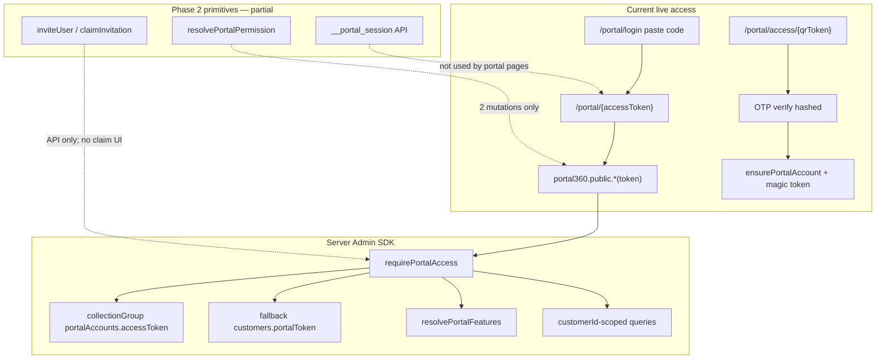

# Customer Portal Phase 2 — Checkpoint P2-S0

**Phase:** PORTAL-P2  
**Checkpoint:** P2-S0 — Baseline, Security Audit, and Implementation Plan  
**Status:** COMPLETE  
**Date:** 2026-07-31  
**Branch:** `production/yuletide-cleanup-launch-readiness`  
**Commit SHA (HEAD):** `c0cae35a23f96cf3dc08c6f98842c04777775853`  
**Working tree:** Dirty — Phase 1 portal harden + partial Phase 2 primitives uncommitted (see git status)  
**ENVIRONMENT:** EMULATOR  
**Production writes:** PROHIBITED  
**Deployment:** PROHIBITED

---

## 1. Mission outcome

This checkpoint verifies the **current** Customer Portal implementation from the repository, documents the real architecture, inventories security gaps against Phase 2 requirements, and locks an exact implementation sequence.

It does **not** redesign the portal, invent workflows, deploy rules/indexes/Hosting/Functions, or write to production Firebase.

**Note on prior docs:** `portal-phase-2-completion.md` previously recorded `COMPLETE_WITH_LIMITATIONS` for broad Phase 2 work. That status is **superseded for program control**. Full Phase 2 remains **IN PROGRESS**. Only **P2-S0** is complete. Subsequent checkpoints (S1+) execute the plan below.

---

## 2. Phase 1 capability verification

Reference: `docs/production-cleanup/portal-phase-1-completion.md`

| Capability                           | Verified      | Evidence                                                                            |
| ------------------------------------ | ------------- | ----------------------------------------------------------------------------------- |
| `PortalAccount` / `PortalUser` types | YES           | `packages/types/src/portal.ts`                                                      |
| Timeline / notification types        | YES           | same                                                                                |
| Portal feature keys                  | YES           | `PortalFeatureKey`, `PORTAL_FEATURES`                                               |
| Token dual-write                     | YES           | `ensurePortalAccount` writes `portalAccounts.accessToken` + `customers.portalToken` |
| Enable / revoke / rotate / suspend   | YES           | `portal360.ts` + staff router                                                       |
| Backfill                             | YES           | `backfillPortalAccountsForOrg` + `portal360.backfillAccounts`                       |
| Sanitized customer DTOs              | YES           | `toPublicCustomer` allowlist                                                        |
| Customer-scoped queries              | PARTIAL       | `colListByCustomerId` primary; **org-wide `colList` fallback** on index miss        |
| Staff `CustomerPortalCard`           | YES           | `customer-overview.tsx`                                                             |
| Separate `PortalShell`               | YES           | `portal-shell.tsx`; portal layout has no `AppShell`                                 |
| Feature-gated nav                    | YES           | `PortalShell` / `PortalAuthedFrame`                                                 |
| Creator entitlements                 | YES           | `creator360` + creator console UI                                                   |
| Tenant portal settings               | YES           | settings customer-portal page + `updatePortal`                                      |
| Firestore rules (portal collections) | YES (in repo) | `firestore.rules` staff-only client access                                          |
| Indexes (token / portal)             | YES (in repo) | `firestore.indexes.json` — **not deployed**                                         |
| Unit / rules tests                   | YES           | `portal.test.ts`, `portal360.test.ts`, rules suite                                  |

**Verdict:** Phase 1 foundation is present and verifiable. Do not re-implement Phase 1 unless a defect is found.

---

## 3. Real architecture (as implemented)

### Access model (authoritative today)

1. **Primary:** Magic URL token in path/body → `requirePortalAccess` → Admin SDK reads.
2. **QR:** Hashed QR token + OTP → activates/ensures portal account → redirects to magic-token portal URL.
3. **Login paste:** Client navigates to `/portal/{token}` (same token path).
4. **Staff cookie `__session`:** Gates `/app` and `/creator` only. Not used for portal.
5. **Portal cookie `__portal_session`:** Implemented (API + helpers) but **not consumed by portal pages or most procedures**.

### Data model (org-scoped)

| Collection                                                                          | Role                                                |
| ----------------------------------------------------------------------------------- | --------------------------------------------------- |
| `portalAccounts`                                                                    | 1:1 customer; `accessToken`, status, sessionVersion |
| `portalUsers`                                                                       | Roles, invitation hashes, `authUserId`              |
| `portalTimelineEvents`                                                              | Customer-visible timeline                           |
| `portalNotifications`                                                               | Per portal user                                     |
| `portalQrCodes` / `portalQrScans` / `portalQrVerifications` / `portalQrAuditEvents` | QR + OTP                                            |

Public portal I/O uses **Firebase Admin SDK** (not client SDK rules as the portal auth boundary).

### Staff vs portal separation

| Concern    | Staff                           | Portal                            |
| ---------- | ------------------------------- | --------------------------------- |
| Cookie     | `__session`                     | `__portal_session` (unused by UI) |
| Middleware | `/app`, `/creator`              | `/portal/*` public                |
| Roles      | CRM `UserRole` / settings roles | `PortalUserRole`                  |
| Shell      | `AppShell`                      | `PortalShell`                     |

---

## 4. Inventories

### 4.1 Routes (`apps/web/src/app/portal`)

| Route                              | Purpose           |
| ---------------------------------- | ----------------- |
| `/portal`                          | Redirect → login  |
| `/portal/login`                    | Paste access code |
| `/portal/access/[token]`           | QR landing + OTP  |
| `/portal/[token]`                  | Dashboard         |
| `/portal/[token]/schedule`         | Schedule          |
| `/portal/[token]/schedule-request` | Schedule request  |
| `/portal/[token]/service-request`  | Service request   |
| `/portal/[token]/messages`         | Messages          |
| `/portal/[token]/notifications`    | Notifications     |
| `/portal/[token]/contacts`         | Contacts          |
| `/portal/[token]/sign`             | Signing hub       |
| `/portal/[token]/billing`          | Billing           |
| `/portal/[token]/proposals`        | Proposals         |
| `/portal/[token]/agreements`       | Agreements        |
| `/portal/[token]/properties`       | Properties        |
| `/portal/[token]/mockups`          | Mockups           |
| `/portal/[token]/documents`        | Documents         |
| `/portal/[token]/jobs`             | Jobs              |
| `/portal/[token]/jobs/[jobId]`     | Job detail        |
| `/portal/[token]/takedowns`        | Takedowns         |
| `/portal/[token]/storage`          | Storage           |
| `/portal/[token]/consultations`    | Consultations     |
| `/portal/[token]/reviews`          | Reviews           |
| `/portal/[token]/rebook`           | Rebooking         |

Session API: `/api/portal/session` (GET/POST/DELETE).

**Preserve:** All of the above plus public deep links `/p`, `/pay`, `/a`, `/m`, `/review` (outside portal tree; do not rename).

### 4.2 API procedures (`packages/api/src/routers/portal360.ts`)

**Public:** dashboard, timeline, notifications (+ mark read/all), contacts, serviceRequests, agreements, documents, storage, reviews, referrals, messages, sendMessage, properties, consultations, takedowns, submitScheduleRequest, invoices, proposals, mockups, jobs, jobDetail, signingHub, submitServiceRequest, uploadServicePhoto, submitRebook, rebookInfo, qrLanding, qrSendCode, qrVerify, claimInvitation, establishSession.

**Staff (office):** enable, invite, inviteUser, revokeInvitation, qr\*, revoke, suspend, rotateToken, getAccount, features.

**Admin:** backfillAccounts.

### 4.3 Rules / indexes

- Rules: portal + QR collections → staff CRUD only (`firestore.rules`).
- Indexes: portalToken / accessToken / invitationTokenHash / authUserId collection-group fields + portal composites (`firestore.indexes.json`).
- **Deploy status:** repository only — not authorized to deploy.

---

## 5. Security audit (gaps vs Phase 2 requirements)

| ID     | Severity | Finding                                                                                              | Impact                                                                        |
| ------ | -------- | ---------------------------------------------------------------------------------------------------- | ----------------------------------------------------------------------------- |
| S0-G01 | P1       | Live auth is **magic-token-first**; `__portal_session` not used by portal UI/procedures              | Session revoke/suspend UX incomplete; role switching risk via shared token    |
| S0-G02 | P1       | `resolvePortalPermission` enforced on **2 mutations only** (service request, send message)           | `view_only` / billing / property roles not authoritative on reads/most writes |
| S0-G03 | P1       | Access tokens stored **plaintext** (`accessToken` / `portalToken`); dashboard may echo token         | Token leakage via logs, history, response bodies                              |
| S0-G04 | P1       | Dashboard `NOT_FOUND` distinguishes invalid token (enumeration) vs QR OTP generic messages           | Account/token existence probe                                                 |
| S0-G05 | P1       | No customer invitation-claim UI; Auth association API-only                                           | Claim workflow incomplete end-to-end                                          |
| S0-G06 | P1       | Production OTP/invitation delivery not emulator-gated for all paths; email may include OTP plaintext | Secret in transit logs / provider payloads                                    |
| S0-G07 | P2       | `colListByCustomerId` / notifications / calendar **org-wide fallback** on index miss                 | Amplifies blast radius if filter bugs                                         |
| S0-G08 | P2       | Default `PORTAL_SESSION_SECRET` fallback string for non-prod                                         | Misconfig risk if env unset outside emulator                                  |
| S0-G09 | P2       | Storage rules lack portal user status/role denial                                                    | Relies on Admin SDK for portal file access                                    |
| S0-G10 | P2       | Authenticated Playwright (full lifecycle) not proven on local emulator stack in this checkpoint      | E2E evidence incomplete                                                       |

**Stop-condition scan (S0):** No confirmed cross-tenant or cross-customer bypass found in reviewed `requirePortalAccess` + customerId filters. Property IDs validated on service/schedule requests. Staff/portal cookie names are separate. **P0 cross-tenant leak not observed** in static audit; integration suite exists to prove isolation under emulator.

---

## 6. Phase 2 code already present (partial — do not redo blindly)

| Module                                   | Path                                                                          | Wired end-to-end?                             |
| ---------------------------------------- | ----------------------------------------------------------------------------- | --------------------------------------------- |
| Permission resolver                      | `packages/types/src/portal-permissions.ts`                                    | Partial (tests + 2 APIs)                      |
| Security crypto / rate limit / redaction | `packages/firebase/src/portal-security.ts`                                    | Helpers used by session/QR/invitation         |
| Portal session                           | `packages/firebase/src/portal-session.ts` + `/api/portal/session`             | API only                                      |
| Invitation                               | `packages/firebase/src/portal-invitation.ts`                                  | Staff create/revoke + public claim API; no UI |
| Unit tests                               | `portal-phase2-security.test.ts`                                              | Present                                       |
| Integration                              | `tests/integration/portal/portal-phase2.integration.test.ts`                  | Present (≥60 scenarios)                       |
| Playwright draft                         | `e2e/portal-phase2-security.spec.ts` + `playwright.portal-emulator.config.ts` | Public surfaces; auth lifecycle incomplete    |
| Docs draft set                           | `portal-phase-2-*.md`                                                         | Present; S0 is now authoritative baseline     |

---

## 7. Emulator test environment readiness

| Item                                 | Status                                                                        |
| ------------------------------------ | ----------------------------------------------------------------------------- |
| `firebase.json` emulators            | Present                                                                       |
| `npm run test:firebase-rules`        | Emulator-exec Firestore + Storage                                             |
| `npm run test:integration`           | Emulator-exec Firestore → `tests/integration`                                 |
| Portal integration path              | `tests/integration/portal/`                                                   |
| Unit portal tests                    | Included in `npm test`                                                        |
| Playwright emulator config           | `playwright.portal-emulator.config.ts` (`E2E_BASE_URL=http://127.0.0.1:3000`) |
| Dedicated `npm run emulators` script | **Missing** (use `firebase emulators:exec` via npm scripts above)             |
| Production project contact           | **Not authorized** for this checkpoint                                        |

**Readiness verdict:** Emulator-backed unit, rules, and integration paths are ready for Phase 2 execution. Local Next + Playwright authenticated suite requires an explicit later checkpoint with `E2E_BASE_URL` local.

---

## 8. Explicit restrictions (carry forward)

- No Hosting / Functions / rules / index deploy
- No production writes, token rotation, OTP send, or migration apply against live projects
- No unverified staging project assumed (`yuletide-lighting-staging` is incomplete / not authorized)
- All evidence labeled `ENVIRONMENT=EMULATOR`
- Preserve `/portal/*` URLs, QR, OTP, magic links, and public deep links

---

## 9. Related documents

| Doc                                     | Role after S0                     |
| --------------------------------------- | --------------------------------- |
| `portal-phase-2-s0-baseline.md`         | This checkpoint (authoritative)   |
| `portal-phase-2-implementation-plan.md` | Exact S1+ sequence                |
| `portal-phase-2-baseline.md`            | Superseded summary → points here  |
| `portal-phase-2-defect-register.md`     | Living gap tracker                |
| `portal-phase-2-completion.md`          | Final gate only — not S0 complete |

---

## 10. S0 acceptance

| Criterion                                            | Met                                           |
| ---------------------------------------------------- | --------------------------------------------- |
| Current portal implementation verified from codebase | YES                                           |
| Real architecture documented                         | YES                                           |
| Security gaps identified                             | YES                                           |
| Exact implementation plan prepared                   | YES → `portal-phase-2-implementation-plan.md` |
| Emulator test environment ready                      | YES                                           |
| No deploy / no production write                      | YES                                           |

**P2-S0 STATUS: COMPLETE**
