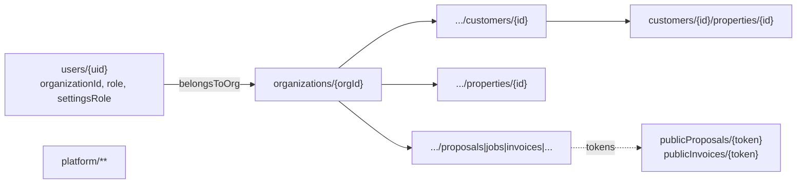
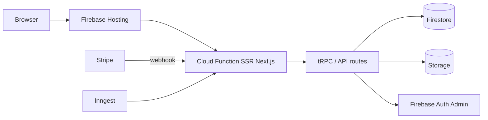
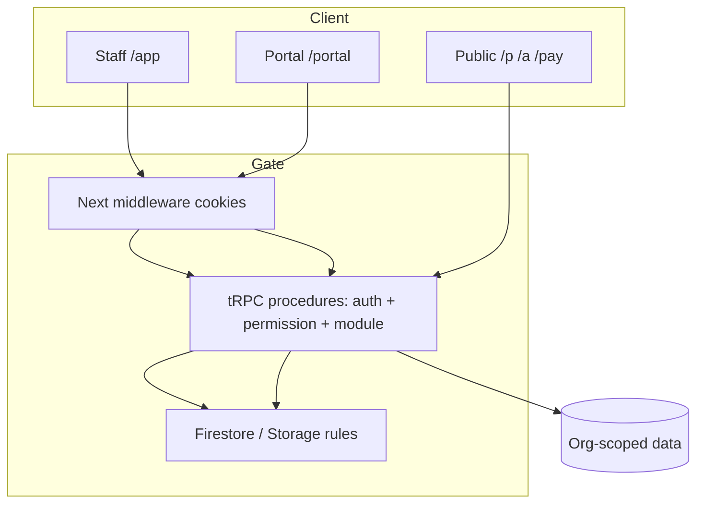

# YL-S0 Baseline — Yuletide Lighting Firebase SaaS

**Program:** YULETIDE-FIREBASE-SAAS  
**Sprint:** YL-S0  
**Worktree:** `C:\Users\jerem\Projects\christmas-light-crm-s8-go-live`  
**Branch at baseline write:** `feat/sneat-theme-tailwind` (also tracks prior release work under `release/yuletide-go-live-readiness`)  
**Firebase projects (from `.firebaserc` — NOT modified):**

| Alias | Project ID |
|-------|------------|
| `default` | `yuletide-lighting` |
| `production` | `yuletide-lighting` |
| `staging` | `yuletide-lighting-staging` |

**Rules-test project (scripts/emulators):** `yuletide-rules-test` (ephemeral emulator project name)

---

## 1. Repository structure

```text
yuletide-lighting/          (npm workspaces + Turbo)
├── apps/
│   ├── web/                Next.js 15 — Hosting SSR source (marketing, /app, /portal, /creator)
│   └── mobile/             Expo crew / field app
├── packages/
│   ├── api/                tRPC routers (*360)
│   ├── firebase/           Admin SDK domain services + Auth helpers
│   ├── types/              domain types, module presets, permissions
│   ├── validators/         zod schemas
│   ├── ui/                 shared UI utils (cn, formatDate, …)
│   └── db/                 legacy Postgres/Drizzle remnants (confirm retire — BACKLOG-008)
├── functions/              (if present) / Hosting frameworksBackend Cloud Function generated at deploy
├── scripts/                deploy, audits, migrations, smokes
├── tests/                  firebase rules + integration suites
├── e2e/                    Playwright
├── firestore.rules
├── firestore.indexes.json
├── storage.rules
├── firebase.json
├── .firebaserc
└── docs/                   production-cleanup, lighting inventory, yuletide-platform (this program)
```

**No `AGENTS.md` at repo root** (searched). Primary ops docs: `README.md`, `docs/production-launch-checklist.md`, `docs/production-cleanup/*`, `docs/lighting/current-state-system-inventory.md`.

---

## 2. Firebase configuration (`firebase.json`)

| Concern | Config |
|---------|--------|
| Hosting | `source: apps/web`, frameworksBackend us-central1 1GiB 120s, production SA by default |
| Firestore | `firestore.rules`, `firestore.indexes.json` |
| Storage | `storage.rules` |
| Emulators | Firestore `127.0.0.1:8080`, Storage `127.0.0.1:9199`, UI disabled, singleProjectMode |
| Deploy wrappers | `scripts/deploy-firebase.mjs` (rewrites SA per target, sanitizes env) — **do not bare `firebase deploy`** |

---

## 3. Application architecture

| Layer | Implementation | Decision |
|-------|----------------|----------|
| Web framework | Next.js 15 App Router + Tailwind | **REUSE** |
| API | tRPC via `/api/trpc` (`packages/api`) | **REUSE** |
| Data | Cloud Firestore (org-nested) | **REUSE** |
| Auth (staff) | Firebase Auth email/password + `__session` HttpOnly cookie | **REUSE** / later **HARDEN** (YL-S2) |
| Auth (portal) | Magic link / QR / OTP + `__portal_session` (Phase 2 complete) | **REUSE** / **HARDEN** HASH_ONLY cutover |
| Mobile | Expo `apps/mobile` crew-scoped | **REUSE** |
| Payments | Stripe Checkout/Connect/webhooks under `/api/stripe`, `/api/webhooks/stripe` | **EXTEND** (YL-S13) |
| Messaging | Twilio + Resend via messages360 | **EXTEND** (YL-S14) |
| Automations | Inngest (`/api/inngest`: proposal follow-up, invoice overdue) | **EXTEND** (YL-S20) |
| Platform admin | Creator console `/creator` gated by `PLATFORM_CREATOR_*` | **REUSE** |
| Modules | Fail-closed `enabledModules` + presets | **REUSE** |

---

## 4. Authentication flow

```mermaid
flowchart TD
  A[Staff: Firebase Auth email/password] --> B[ID token]
  B --> C[POST/GET /api/auth/session]
  C --> D["HttpOnly __session cookie"]
  D --> E[Middleware gates /app /creator]
  E --> F[resolveAppAccess: users/uid + org + roles/permissions]
  F --> G{Active + org?}
  G -->|no| H[/access-denied]
  G -->|yes| I[Staff CRM /app]
  G -->|creator allowlist| J[/creator]

  K[Portal: magic/QR/OTP] --> L[POST /api/portal/session]
  L --> M["HttpOnly __portal_session"]
  M --> N[/portal/app session-first]
```

**Tenant model:** user document carries single `organizationId`. No tenant switcher (Creator manages multi-org). Public lead routing uses `OPERATING_ORGANIZATION_ID`.

---

## 5. Firestore ownership model



**Authoritative ownership:** `organizationId` on user + path `organizations/{orgId}/...`. Dual property/job paths (org SoT vs customer subcollections) documented as **REFACTOR** candidate (BACKLOG-007).

---

## 6. Firestore collections (from `firestore.rules`)

### Top-level

| Collection | Purpose | Ownership / access notes | Decision |
|------------|---------|--------------------------|----------|
| `users` | Staff profiles | Self read; locked org/role fields | **REUSE** |
| `organizations/{orgId}` | Tenant root + all CRM data | `belongsToOrg` / roles | **REUSE** |
| `publicProposals/{token}` | Public proposal access | Token routes | **REUSE** |
| `publicInvoices/{token}` | Public invoice/pay | Token routes | **REUSE** |
| `platform/**` | Creator/platform | Platform controls | **REUSE** |
| `platformAuditLogs` | Platform audit | Platform | **REUSE** |

### Under `organizations/{orgId}` (selected)

| Collection | Purpose | Decision |
|------------|---------|----------|
| `customers` (+ nested properties, activities, designs, jobs, storage, communications) | CRM customers | **REUSE** |
| `properties` | Org-level properties | **REUSE** / **REFACTOR** dual path |
| `proposals` (+ packages, views, approvals) | Estimates/quotes | **EXTEND** (YL-S7) |
| `proposalTemplates` | Templates | **REUSE** |
| `jobs` | Install/service/removal jobs | **EXTEND** (YL-S9) |
| `invoices` (+ payments, activity, reminders, disputes) | Billing | **EXTEND** (YL-S13) |
| `payments`, `reminderTemplates`, `customerStatements`, `collectionsQueue`, `cashFlowForecasts` | AR | **EXTEND** |
| `messages`, `messageThreads`, `conversations`, templates, campaigns, automations, notifications | Messaging | **EXTEND** |
| `mockups` (+ layers, measurements, versions, exports) | Design | **REUSE** |
| `calendarEvents`, `schedules`, `crewSchedules`, `dispatchBoard`, … | Scheduling | **EXTEND** (YL-S10) |
| `inventory*`, warehouses, POs, vendors, audits, truck/customer inventory | Inventory | **EXTEND** (YL-S16) |
| `reports`, dashboards, forecasts, analytics | Reporting | **EXTEND** (YL-S19) |
| `settings`, `roles`, `permissions`, `featureFlags`, `auditLogs` | Org admin | **HARDEN** (YL-S3/S4) |
| `portalAccounts`, `portalUsers`, portal QR/timeline/notifications | Customer portal | **HARDEN** (YL-S12) |
| `signLocations`, `signTrackerSettings` | Yard signs | **REUSE** |
| `serviceIssues`, `consultations`, `contacts`, `projectPrepItems`, `timeEntries`, `storageRecords`, `commercialAccounts`, `multiYearAgreements`, `crmUiConfig` | Ops modules | **REUSE** / **EXTEND** |
| `subscriptionPayments` | SaaS billing | **REUSE** (write denied to clients) |
| `userInvites`, `backups` | Admin | **REUSE** |

Catch-all under org denies unmatched paths (`{document=**}`).

---

## 7. Security rules summary

**Firestore helpers:** `isSignedIn`, `userDoc`, `isActiveUser`, `belongsToOrg`, `hasRole` (legacy role array: owner/admin/office/crew predominantly).

**Known hardening themes (not fixed in S0):**
- Legacy role names in rules vs richer `settingsRole` / permissions in app (**YL-S3/S4**)
- Portal data staff-writable in rules; customer portal access primarily server/session (ticketed files)
- Public token collections are intentionally readable by token holders — validate token secrecy (**YL-S22**)

**Storage:** staff-only direct SDK under `organizations/{orgId}/**`; portal via `/api/portal/files` tickets; `public/**` read-only.

---

## 8. Cloud / HTTP functions inventory

Hosting frameworksBackend compiles Next into Cloud Function `ssryuletidelighting*` (prod/staging).

### Next.js API routes (selected)

| Route | Role |
|-------|------|
| `/api/trpc/[trpc]` | Primary staff/portal API |
| `/api/auth/session` | Staff session cookie |
| `/api/portal/session`, `files`, `claim-invitation`, `authorize-route` | Portal session/files |
| `/api/webhooks/stripe` | Stripe webhook (signature verify) |
| `/api/stripe/**` | Checkout, billing, subscription |
| `/api/inngest` | Background jobs |
| `/api/upload`, `/api/files` | Staff uploads/files |
| `/api/maps/token` | Mapbox token |
| `/api/health` | Health |

Dedicated classic Cloud Functions codebase may be minimal — Hosting SSR Function is primary server surface.

---

## 9. tRPC / domain routers (`packages/api`)

`agreements360`, `automation360`, `billing`, `commercial360`, `contacts360`, `creator360`, `crew360`, `crm-ui-config`, `customer360`, `firestore` (legacy), `import360`, `inventory360`, `invoices360`, `messages360`, `mockups360`, `onboarding360`, `portal360`, `projectPrep360`, `proposals360`, `rebooking360`, `reports360`, `reviews360`, `schedule360`, `serviceIssues360`, `settings360`, `signTracker360`, `site-cms-extended`, `storage360`, `timeClock360`, `website-cms`.

---

## 10. Business capability matrix

| Capability | Current State | Implementation | Firestore | Functions/Routes | Rules | Tests | Decision | Notes |
|------------|---------------|----------------|-----------|------------------|-------|-------|----------|-------|
| Organizations / users | Working | Auth + users/{uid}, org docs, Creator | users, organizations | session, creator360 | yes | tenant-isolation unit/integration | **REUSE** | Single-org membership |
| Auth / session | Working | Firebase Auth + cookie | users | `/api/auth/session` | yes | staging/prod AUTH smokes | **HARDEN** | YL-S2 |
| RBAC / permissions | Partial dual | settings roles + legacy role in rules | roles, permissions, settings | settings360 | legacy roles | permission integration | **HARDEN** | YL-S3/S4 |
| Customers / properties | Working | customer360 | customers, properties | tRPC | yes | integration | **REUSE** | Dual property paths |
| Leads / pipeline | Working | pipeline / customer360 | customers status | tRPC | — | checklist ops | **EXTEND** | YL-S6 |
| Estimates / proposals | Working | proposals360 + packages subcollection | proposals | tRPC, `/p/[token]` | yes | unit + acceptance tests | **EXTEND** | Package edit-on-edit gap BACKLOG-002 |
| Contracts / acceptance | Working | proposal-acceptance, agreements360 | proposals, agreements | `/a/[token]` | yes | acceptance tests | **EXTEND** | YL-S8 |
| Jobs / work orders | Working | jobs360 / crew | jobs | tRPC, mobile | crew read | — | **EXTEND** | YL-S9 |
| Scheduling | Working | schedule360 | calendar/schedules/* | tRPC | yes | schedule tests | **EXTEND** | YL-S10 |
| Crew / field | Working | crew360 + Expo | jobs, schedules | mobile | crew | — | **EXTEND** | YL-S11 |
| Customer portal | Working Phase 2 | portal360 | portal* | portal APIs | staff rules + server | portal integration S1–S7 | **HARDEN** | HASH_ONLY prod BACKLOG-004 |
| Billing / payments | Working code; ops wiring open | invoices360, Stripe | invoices, payments | stripe + webhooks | yes | safe-mode | **EXTEND** | YL-S13 |
| Notifications / email / SMS | Partial | messages360, Inngest, Resend/Twilio | messages* | inngest | yes | — | **EXTEND** | YL-S14 |
| Photos / files | Working | Storage + tickets | Storage paths | upload/files/portal files | storage rules | portal file audits | **HARDEN** | YL-S15 |
| Inventory | Working when module on | inventory360 | inventory* | tRPC | yes | — | **EXTEND** | YL-S16 |
| Renewals / rebooking | Working when module on | rebooking360 | — | tRPC | — | — | **EXTEND** | YL-S17 |
| Admin shell / nav | Working fail-closed modules | app-shell, crmUiConfig | crmUiConfig, enabledModules | — | — | e2e smokes | **EXTEND** | YL-S18; Sneat BACKLOG-001 |
| Reporting | Working when module on | reports360 | reports* | tRPC | yes | — | **EXTEND** | YL-S19 |
| Background jobs | Minimal | Inngest 2 functions | — | `/api/inngest` | n/a | — | **EXTEND** | YL-S20 |
| Security rules testing | Present | vitest rules tests | — | emulators | suite | `test:firestore-rules` etc. | **HARDEN** | YL-S4/S22 |
| Website / CMS | Working | website-cms | CMS collections | public site | — | — | **REUSE** | |

---

## 11. Hosting / Functions flow



---

## 12. Security boundary



Defense in depth: middleware ≠ authorization; tRPC checks ≠ rules; rules alone ≠ app auth.

---

## 13. Verification commands (repo-defined)

| Script | Purpose |
|--------|---------|
| `npm test` | Unit (firebase package + selected types) |
| `npm run test:integration` | Emulator integration batches |
| `npm run test:firestore-rules` / `test:storage-rules` / `test:firebase-rules` | Rules |
| `npm run lint` / `typecheck` / `build` | Quality |
| `npm run test:e2e` / `test:e2e:staging` | Playwright |
| `npm run production:check` | Launch gates (no deploy by itself) |

Results recorded in `sprints/YL-S0-COMPLETE.md`.

---

## 14. Unrelated local work (preserve)

At baseline time, branch `feat/sneat-theme-tailwind` had **uncommitted** proposal-package and related edits. YL-S0 commits **only** `docs/yuletide-platform/**` and must not revert or force-clean that workstream.

---

## 15. S0 forbidden actions (observed)

No Firebase deploy, no production writes, no feature implementation, no YL-S1 start.
